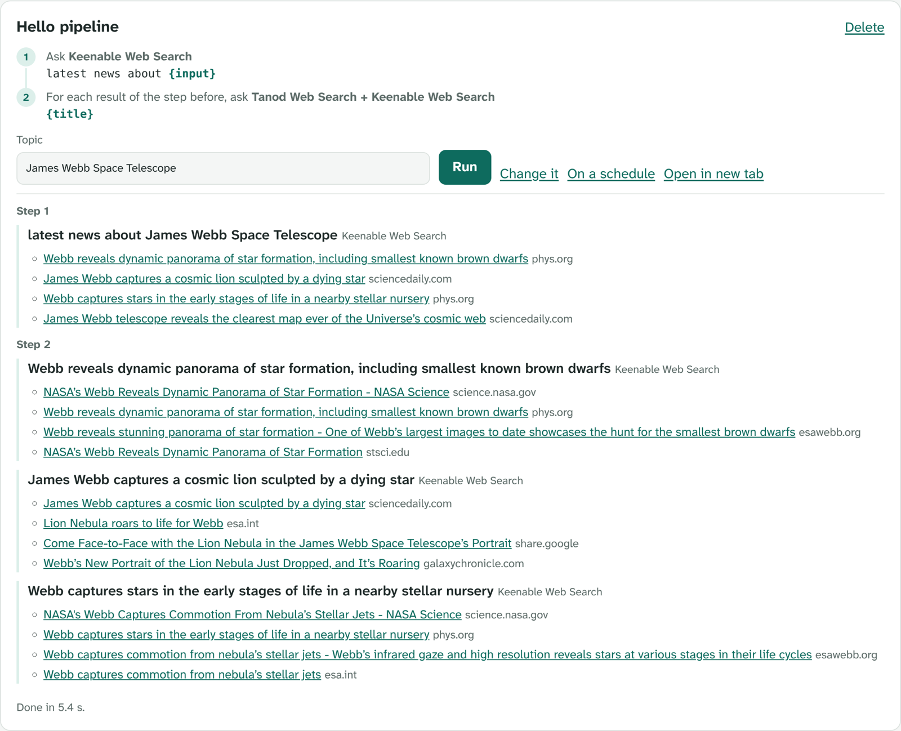

# Build your own pipeline

A pipeline is a short chain of questions. Each step asks one to three MCP servers something,
and a step can use what the step before found: a headline, a link, an answer. "Find the latest
news, then the full story for each headline" is a two-step pipeline.

You don't need an AI model or any code: pipelines work in free mode, the same way a search does.

- [Your first pipeline in two minutes](#your-first-pipeline-in-two-minutes)
- [The parts of a step](#the-parts-of-a-step)
- [Placeholders: passing results along](#placeholders-passing-results-along)
- [Choosing servers](#choosing-servers)
- [A three-step example](#a-three-step-example)
- [Run it on a schedule](#run-it-on-a-schedule)
- [Writing pipelines as JSON](#writing-pipelines-as-json)
- [Test one, and share it](#test-one-and-share-it)
- [Tips](#tips)
- [Limits](#limits)

## Your first pipeline in two minutes

1. Open **Pipelines** (type `mcp://pipelines` in the address bar) and press **New pipeline**.
2. Fill in the top of the form:
   - **Name**: `Hello pipeline`
   - **What you type when you run it**: `Topic`
   - **Example**: `James Webb Space Telescope`
3. Step 1: ask `latest news about {input}`, servers `keenable`.
4. Press **Add a step**. Step 2: ask `{title}`, tick **once for each result of the step before**,
   servers `tanod-web, keenable`.
5. Press **Save**, then **Run** on your new card.

What you get (a real run in the desktop app, October 23, 2026, done in 5.4 seconds): step 1
lists the latest headlines, such as "Webb reveals dynamic panorama of star formation" on
phys.org. Step 2 runs once for each of the first three and brings back other coverage of each
one: NASA Science's own page, ESA's, the Space Telescope Science Institute's.



To start from a pipeline that already works, press **Change it** on any card in the library.
Saving makes it your own copy and leaves the original alone.

## The parts of a step

| Part | What it does |
|---|---|
| **Ask** | The question for this step. Write it the way you'd search: `latest news about {input}`, `{input} stock price today`. |
| **Servers** | Which servers to ask, by id, separated by commas (up to three). Leave it empty and MCP Browser chooses, as it does for a search. |
| **Once for each result of the step before** | Turns the step into a loop: it runs once per result of the previous step, and `{title}`, `{url}` and `{host}` are that result. Not available on step 1. |

## Placeholders: passing results along

Write these in a step's question. They are replaced just before the step runs.

| Placeholder | Becomes | Where it works |
|---|---|---|
| `{input}` | What you typed when you pressed Run | Every step |
| `{answer}` | The previous step's short answer, when a server gave one (up to 200 characters) | Step 2 onwards |
| `{titles}` | The titles the previous step found, separated by commas | Step 2 onwards |
| `{title}` | One result's title | "For each" steps |
| `{url}` | One result's link | "For each" steps |
| `{host}` | One result's website, such as `nasa.gov` | "For each" steps |

A few things to know:

- **Steps see only the step just before them.** In a three-step pipeline, step 3's `{title}`
  comes from step 2's results, not step 1's.
- **`{input}` works in every step.** That's how steps can ask separate questions about one
  thing: the Company brief starter asks for a stock quote, a description and the news, all
  about `{input}`.
- **Values are cut to one line** (about 160 characters, 200 for `{answer}`), so a long title
  can't take over the question.

## Choosing servers

Any of these work in the **Servers** box:

- **Leave it empty.** MCP Browser picks servers for the question, the same way it does for a
  search. Good for a first try.
- **A curated server's short id.** Web search: `keenable`, `exa`, `tanod-web`, `agentsearch`.
  Encyclopedia: `wikexa`. Papers: `research-papers`, `pubmed-community`. Code and docs:
  `deepwiki`, `gitmcp`, `context7`, `mslearn`, `aws-knowledge`. Markets: `marketcrew`.
  Weather: `weather-worldwide`.
- **Any server from the MCP Registry, by its full name**, such as
  `io.github.MCPServings/paper-mcp`. To find names for a topic, run
  `node bin/cli.js --servers "flight prices"` in the project folder. It lists the matching
  servers, best first, with their names. The **MCP Rank** page also shows each server's name
  under its title.

A server you've switched off in Settings stays off, even when a pipeline names it. Pipelines
only use tools that read: a server's tools that change things (send, delete, book) are never
offered, here or anywhere else in MCP Browser.

### Your own servers, with keys

You can build pipelines around servers of your own: one you added (Servers → Add a server), one
you gave a key (Add key on it), one you signed in to, or a package server you approved to run on
your computer. Put its id in a step's **Servers** box, then **save** the pipeline.

The first time you save a pipeline that uses one of your servers, MCP Browser shows each step
that would, with any tool it calls and the arguments it sends, and asks you to **Save and
allow**. After that, the card says which of your servers it uses.

Only your saved copy runs with them. Run any other way, a pipeline uses only hosted servers
that need no key or sign-in, both the servers its steps name and the ones MCP Browser picks
when a step names none:

- a pipeline from the library, or one someone sent you;
- a saved pipeline that was changed somewhere else and not saved again.

That way a pipeline someone else wrote can't use your keys or read your private servers and
pass what they return on to another server. Before you save one that came from someone else,
read its steps in **Change it**: tool calls and their arguments are shown there too. A schedule
made from your saved copy uses your servers only while that copy is unchanged; change or delete
it and the schedule runs by the stricter rule.


## A three-step example

"A new release, then the problems people hit": what changed in a new version of a tool,
then what people ran into after upgrading, then a closer look at each of those reports.

| Step | Ask | Servers | For each |
|---|---|---|---|
| 1 | `{input} what's new release notes` | `keenable, tanod-web` | |
| 2 | `{input} upgrade problems bugs` | `keenable` | |
| 3 | `{title}` | `tanod-web, keenable` | yes |

With `Python 3.14` as the input, step 1 found "What's new in Python 3.14" on docs.python.org
and Real Python's feature tour. Step 2 found reports such as "Python 3.10 to 3.14: what breaks
when you upgrade, tested". Step 3 then went through those reports one at a time. The whole run
took about 7 seconds.

Steps 1 and 2 don't depend on each other: both use only `{input}`. Step 3 depends on step 2.

## Run it on a schedule

Press **On a schedule** on a pipeline's card and choose every hour, day or week. You can add
words to stop on: **stop when the result mentions** `released`, or `$199`. The pipeline then
runs until a result says that, then stops and marks the watch with the sentence that said
it. Each run's results, and what changed since the last one, show up in **Watches**
(`mcp://watches`).

To open a pipeline in its own tab, use **Open in new tab**, or Ctrl/⌘-click **Run**. The tab
has an address you can bookmark, such as
`mcp://pipelines/fx-three-sources?input=USD%20to%20JPY`.

## Writing pipelines as JSON

The form covers almost everything. Under it, a pipeline is a small JSON object, and writing
it by hand gives you one more setting, `max`:

```json
{
  "id": "release-then-problems",
  "title": "A new release, then the problems people hit",
  "description": "What changed in a new version of a tool, then what people ran into after upgrading.",
  "input": { "label": "Tool and version", "example": "Python 3.14" },
  "steps": [
    { "ask": "{input} what's new release notes", "servers": ["keenable", "tanod-web"], "max": 3 },
    { "ask": "{input} upgrade problems bugs", "servers": ["keenable"] },
    { "ask": "{title}", "each": true, "servers": ["tanod-web", "keenable"], "max": 2 }
  ]
}
```

- **`max` on a normal step** is how many of its results the next step gets (default 5).
- **`max` on a "for each" step** is how many results of the step before it goes through
  (default 3, at most 5).

The pipelines you save in the app are kept in `~/.mcp-browser/pipelines.json`
(`{ "pipelines": [ … ] }`), or in `MCPB_DATA_DIR` if you set it. You can edit that file while
the app is closed. Anything that doesn't fit the format is trimmed or refused when the
pipeline runs, for example a sixth step or a fourth server.

## Test one, and share it

Put one or more pipelines in a JSON file (a list, like `[ { … }, { … } ]`), then run them end
to end, the way the Pipelines page does:

```bash
node scripts/test-pipelines.mjs my-pipelines.json --dump what-each-step-got.json
```

A step passes when it got an answer, a link or an on-topic reply. A "for each" step passes
when at least half its runs did. `--dump` writes everything each step got, so you can read it
and see whether the results are actually useful, not just present.

**To add a pipeline to the library for everyone:**

1. Add it to `src/data/pipeline-library.json`, with a `category`: one of `finance`,
   `science`, `travel`, `business`, `developer`, `security`, `learning` or `everyday`.
2. Run `node scripts/test-pipelines.mjs --only your-id --write`. This runs it and stamps it
   with the date it passed.
3. Open a pull request on [GitHub](https://github.com/KrishnaMaddireddy/mcp-browser) and paste
   a line or two of what it found.

## Tips

- **Make each step ask something new.** A "for each" step that asks only `{title}` often finds
  the same page again. Add words that send it somewhere else: `{title} reactions`,
  `{title} criticism`, `{title} pdf`.
- **Use different servers for different jobs.** A paper server for step 1 and a web search for
  step 2 gives you two kinds of sources, not the same one twice.
- **Keep "for each" small.** Three results times two servers is already six searches. A `max`
  of 2 or 3 keeps a run under ten seconds.
- **Try the question as a normal search first.** If a search for `latest news about {input}`
  finds good results with your example, it will work as a step.
- **If a step finds nothing**, the steps after it that go through its results say so and stop.
  Check that step's servers, or leave the Servers box empty so MCP Browser chooses.
- **Results are other people's text.** A pipeline shows you what servers and pages said. Cross-check
  anything that matters (`mcp://check`).

## Limits

| | |
|---|---|
| Steps per pipeline | 5 |
| Servers per step | 3 |
| Results a "for each" step goes through | up to 5 (default 3) |
| Question length | 300 characters as written, 500 once filled in |
| Saved pipelines | 50 (the oldest go first) |
